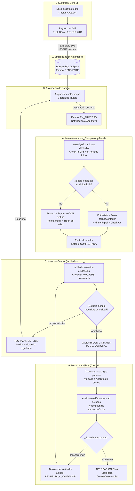
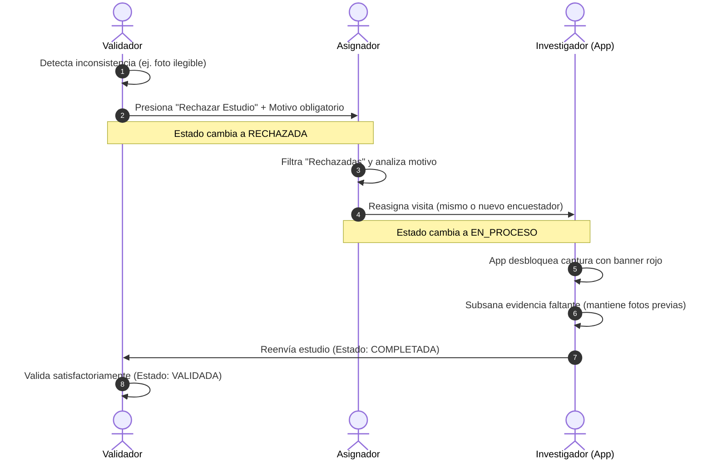

# 📘 MANUAL DE PROCESOS OPERATIVOS
## Sistema de Gestión y Auditoría de Investigaciones Domiciliarias
### Caja Popular Oblatos S.C. de A.P. de R.L. de C.V. (CPO)

---

| Campo | Detalle Institucional |
|---|---|
| **Institución:** | Caja Popular Oblatos S.C. de A.P. de R.L. de C.V. |
| **Sistema:** | Plataforma Integral CPO Investigaciones (Web, Móvil & ETL SIF) |
| **Versión:** | 2.5 (Edición Operativa Multirrol) |
| **Áreas:** | Crédito, Mesa de Control/Validación, Operación de Campo, Mesa de Análisis |
| **Fecha de Emisión:** | Octubre 2026 |
| **Clasificación:** | Manual de Procesos Interno y Normativo |

---

## 📑 Índice General
1. [Objetivo y Alcance del Manual](#1-objetivo-y-alcance)
2. [Matriz de Roles y Responsabilidades (RBAC / RACI)](#2-matriz-de-roles-y-responsabilidades)
3. [Mapa General de Procesos (End-to-End)](#3-mapa-general-de-procesos)
4. [Proceso 1: Ingesta y Sincronización Automática (SIF → PostgreSQL)](#4-proceso-1-ingesta-y-sincronización-sif--postgresql)
5. [Proceso 2: Asignación y Ruteo de Investigaciones de Campo](#5-proceso-2-asignación-y-ruteo-de-investigaciones)
6. [Proceso 3: Ejecución de Visita Domiciliaria en App Móvil](#6-proceso-3-ejecución-de-visita-domiciliaria-en-app-móvil)
7. [Proceso 4: Protocolo de Ausencia / No Localizado ("Supuesto Con Folio")](#7-proceso-4-protocolo-de-ausencia-supuesto-con-folio)
8. [Proceso 5: Mesa de Control y Validación de Calidad de Evidencias](#8-proceso-5-mesa-de-control-y-validación-de-calidad)
9. [Proceso 6: Circuito de Rechazo, Devolución y Reasignación](#9-proceso-6-circuito-de-rechazo-devolución-y-reasignación)
10. [Proceso 7: Distribución y Dictamen Crediticio (Mesa Analítica)](#10-proceso-7-distribución-y-dictamen-crediticio)
11. [Proceso 8: Cancelación Lógica (*Soft-Delete*) y Auditoría Forense](#11-proceso-8-cancelación-lógica-y-auditoría-forense)
12. [Indicadores Clave de Desempeño (KPIs y SLAs)](#12-indicadores-clave-de-desempeño)
13. [Preguntas Frecuentes y Políticas Operativas](#13-preguntas-frecuentes-y-políticas-operativas)

---

## 1. Objetivo y Alcance

### 1.1 Objetivo
Estandarizar las actividades, criterios técnicos, responsabilidades y tiempos de respuesta que rigen la administración, levantamiento en campo, auditoría documental, validación socioeconómica y dictamen de investigaciones crediticias de **Solicitantes** y **Avales** en Caja Popular Oblatos.

### 1.2 Alcance
Aplica a todo el personal involucrado en el circuito crediticio:
- Personal de sucursales (captura de solicitudes en SIF).
- Mesa de asignación y logística de campo.
- Investigadores de campo (uso de la aplicación móvil).
- Mesa de control y validación de expedientes.
- Mesa analítica de crédito (coordinación y analistas).
- Auditoría interna y dirección de TI.

---

## 2. Matriz de Roles y Responsabilidades

El sistema implementa un esquema estricto de **Gobernanza RBAC (*Role-Based Access Control*)**:

| Rol en Sistema | Perfil Organizacional | Plataforma | Atribuciones Principales | Restricciones Clave |
|---|---|---|---|---|
| `superadmin` | Dirección de TI / SysAdmin | Web Admin | Control total, gestión de usuarios, auditoría forense, base de datos. | Restringido exclusivamente al área de TI. |
| `admin` | Jefatura de Crédito | Web Admin | Visión macro, monitoreo global de folios, catálogos, mapas y reportes. | No puede crear ni eliminar cuentas de usuarios. |
| `asignador` | Coordinación de Campo | Web Admin | Distribuir y reasignar visitas a encuestadores, monitoreo GPS de rutas. | No valida expedientes ni emite dictámenes de crédito. |
| `investigador` | Encuestador de Campo | App Móvil | Check-in GPS, llenado socioeconómico, captura fotográfica, firma digital. | Acceso único a su propia cola del día; sin acceso al portal web. |
| `validador` | Mesa de Control | Web Admin | Revisión minuciosa de fotos/GPS, dictamen de validación, rechazos y cancelación lógica. | Filtro previo obligatorio antes de que el expediente pase a analistas. |
| `coordinadora_analistas` | Supervisión Analítica | Web Admin | Visión de paquetes validados por sucursal, distribución balanceada de carga a analistas. | Supervisión gerencial; asigna expedientes a su equipo. |
| `analista` | Analista de Crédito | Web Admin | Dictamen financiero final (ingresos vs gastos). Devolución al validador si hay anomalías. | **Visibilidad restringida:** solo visualiza los folios asignados a su persona. |
| `auditor` | Cumplimiento / Auditoría | Web Admin | Inspección inalterable de logs (`audit_log`), métricas históricas y tiempos SLA. | Perfil 100% de solo lectura; sin edición ni dictamen. |

---

## 3. Mapa General de Procesos



---

## 4. Proceso 1: Ingesta y Sincronización (SIF → PostgreSQL)

### 4.1 Responsable
- Motor automatizado ETL (`sync_engine.js` / Docker).
- Supervisión: Área de TI / Administrador.

### 4.2 Detonante y Frecuencia
- Cada **60 segundos** de forma continua (`--watch`).

### 4.3 Flujo Secuencial
1. **Detección de Cambios en SIF:**
   El motor consulta `LOA.LoanResearch` en SQL Server buscando registros creados o modificados.
2. **Extracción y Transformación de Datos en Cascada:**
   - **Proceso A:** Sincroniza datos personales del cliente (`PER.Person` y `PER.IndividualPerson`) a la tabla `personas`.
   - **Proceso B:** Sincroniza el domicilio principal vigente (`PER.Address`) a `direcciones`.
   - **Proceso C:** Sincroniza la solicitud (`LOA.CreditLine`) a `solicitudes_credito`.
   - **Proceso D:** Extrae las garantías y datos de avales (`LOA.CreditLineGuarantee`) e inserta a `solicitud_avales` y `personas` (`es_aval = TRUE`).
   - **Proceso E:** Genera el registro de la orden en `investigaciones` con estado inicial `PENDIENTE`.
3. **Estrategia UPSERT:**
   Se utiliza `ON CONFLICT (id_sif) DO UPDATE` para garantizar idempotencia y evitar duplicidad.

---

## 5. Proceso 2: Asignación y Ruteo de Investigaciones

### 5.1 Responsable
- Rol: `asignador` o `admin`.

### 5.2 Pasos Operativos
1. **Acceso:** Iniciar sesión en el portal web y dirigirse a **Investigaciones Domiciliarias**.
2. **Identificación de Casos:**
   - Filtrar por estado `Pendientes ⏳`.
   - Consultar la vista de **Mapa Satelital GPS** para verificar la dispersión geográfica de las visitas en la Zona Metropolitana y foráneas.
3. **Asignación Individual:**
   - Hacer clic en el botón `Asignar` del registro deseado.
   - En el modal desplegable, seleccionar al investigador activo considerando su zona asignada y número de visitas en curso.
   - Confirmar la acción. El estado cambia a `EN_PROCESO` y se emite notificación en tiempo real a la app móvil.
4. **Asignación en Lote (Masiva):**
   - Seleccionar mediante las casillas de verificación (checkboxes) los casos ubicados en un mismo sector o código postal.
   - Presionar `Asignar Lote (N)`.
   - Seleccionar al investigador asignado y confirmar.

---

## 6. Proceso 3: Ejecución de Visita Domiciliaria en App Móvil

### 6.1 Responsable
- Rol: `investigador` (en campo).

### 6.2 Pasos Operativos
1. **Recepción y Agenda:**
   - El encuestador abre la aplicación móvil CPO e inicia sesión con sus credenciales.
   - En la sección **Mis Visitas Asignadas**, visualiza las órdenes en estado `EN_PROCESO`.
2. **Navegación:**
   - Pulsa el botón de navegación GPS para transferir las coordenadas a **Google Maps** o **Waze**.
3. **Arribo y Check-In:**
   - Al llegar al inmueble, presiona el botón **📍 Check-In Arribo**.
   - El sistema captura de forma automática:
     - Coordenadas GPS del punto de captura.
     - Estampa de tiempo exacta (inicio de la visita).
4. **Entrevista y Captura de Datos:**
   - Diligenciamiento de las secciones socioeconómicas:
     - Datos generales del habitante y parentesco con el titular/aval.
     - Características del inmueble (niveles, tipo de fachada, cancel, propiedad propia/rentada).
     - Bienes muebles visibles y vehículos.
     - Comprobación de ingresos y actividad económica.
5. **Captura Fotográfica Obligatoria:**
   - Fachada completa con número exterior legible visible.
   - Calle y contexto de ubicación.
   - Interior del inmueble / área de trabajo.
   - Identificación oficial presentada (INE/Pasaporte).
   - *Nota: Las fotografías llevan estampa de agua digital con fecha, hora y coordenadas GPS.*
6. **Firma Digital:**
   - Captura en pantalla táctil de la firma del entrevistado y firma del investigador.
7. **Cierre de Visita (Check-Out):**
   - Presionar **Check-Out Finalizar**.
   - El sistema calcula la duración de la entrevista (minutos) y cambia el estado a `COMPLETADA`.

---

## 7. Proceso 4: Protocolo de Ausencia ("Supuesto Con Folio")

### 7.1 Responsable
- Rol: `investigador` en campo.

### 7.2 Justificación
Evitar visitas infructuosas repetidas, desgaste de recursos y prevenir cruces cuando el socio ha acudido directamente a la sucursal.

### 7.3 Pasos Operativos ante No Localización
1. **Verificación de Domicilio:**
   - Si tras tocar al domicilio nadie atiende o el socio no se encuentra presente:
2. **Captura de Evidencia de Visita:**
   - Tomar fotografía de la fachada con el número exterior visible.
   - Indagar brevemente con vecinos contiguos si el socio efectivamente habita en dicho domicilio (sin revelar secretos financieros).
3. **Emisión del Comprobante / Ticket:**
   - Dejar bajo puerta o en buzón el citatorio oficial institucional que contiene la leyenda impresa:
     `FOLIO INVESTIGACIÓN: {id_investigacion}`
4. **Registro en App:**
   - Seleccionar dictamen en campo: `NO LOCALIZADO / CITATORIO DEJADO`.
   - Especificar fecha, hora y con quién se dejó el recado (si aplica).
   - El sistema pone el caso en estado `COMPLETADA` con etiqueta de aviso para la Mesa de Control y la Sucursal.

---

## 8. Proceso 5: Mesa de Control y Validación de Calidad

### 8.1 Responsable
- Rol: `validador` (Mesa de Control).

### 8.2 Criterios de Aprobación (Checklist de Calidad)
Antes de emitir dictamen, el validador debe verificar:
- [ ] **Fachada y Número:** Fotografía nítida donde se aprecie claramente el número exterior oficial coincidente con el sistema.
- [ ] **Geolocalización GPS:** El pin de captura del check-in debe situarse en el radio permitido respecto a la dirección registrada en SIF.
- [ ] **Identidad:** Especificación clara de quién atendió la visita y presentación de identificación oficial.
- [ ] **Integridad del Paquete de Crédito:** Si el crédito cuenta con avales, se debe comprobar que el 100% de las visitas asociadas (titular y avales) estén concluidas antes de autorizar el paquete completo.

### 8.3 Procedimiento de Validación Favorable
1. Ingresar al **Detalle de la Investigación**.
2. Revisar el visor HD de fotografías (zoom y rotación).
3. Hacer clic en **✅ Validar con Dictamen**.
4. Escribir observaciones institucionales (o seleccionar plantilla rápida).
5. Confirmar. El estado pasa a `VALIDADA` y se estampa el sello digital con nombre, fecha y hora en el pie de firma del formato oficial.

---

## 9. Proceso 6: Circuito de Rechazo, Devolución y Reasignación



### 9.1 Procedimiento para Rechazar un Estudio
1. En la barra superior del expediente, presionar el botón rojo **❌ Rechazar Estudio**.
2. En la ventana modal emergente, redactar de forma explícita el motivo. *Ejemplos válidos:*
   - *"La fotografía de la fachada está oscura y no se distingue el número oficial."*
   - *"No se capturó la fotografía de la identificación oficial del aval."*
   - *"Existe discrepancia entre el domicilio físico visitado y la calle registrada en el folio."*
3. Presionar **Confirmar Rechazo**. El sistema cambia el estado a `RECHAZADA` y lo envía a la cola del Asignador.

### 9.2 Reasignación por el Coordinador
1. El Asignador entra a la tabla y selecciona el filtro `Rechazadas ❌`.
2. Lee el motivo indicado por el validador en la columna de dictamen.
3. Presiona **Asignar**:
   - **Mismo investigador:** Si se trata de subsanar un dato menor o foto complementaria.
   - **Nuevo investigador:** Si el encuestador original cambió de ruta o se requiere peritaje imparcial.
4. Al confirmar, el estado vuelve a `EN_PROCESO`.

### 9.3 Corrección en la App Móvil
1. La tarjeta del caso aparece en la app con un distintivo rojo:
   `❌ RECHAZADA — Corrección Requerida: {Motivo del Validador}`.
2. Al pulsar **Capturar Estudio**, el formulario se desbloquea manteniendo la información y fotos previamente cargadas.
3. El investigador toma la fotografía faltante o rectifica el campo solicitado y pulsa **Guardar Estudio** para retornar a `COMPLETADA`.

---

## 10. Proceso 7: Distribución y Dictamen Crediticio

### 10.1 Responsable
- Roles: `coordinadora_analistas` y `analista` de crédito.

### 10.2 Distribución de Carga (Supervisión)
1. La Coordinadora de Analistas accede a la vista de expedientes con estado `VALIDADA`.
2. Utiliza los filtros multiselección por sucursal de origen y carga de trabajo de su equipo.
3. Asigna el paquete crediticio completo al Analista correspondiente.

### 10.3 Evaluación y Dictamen del Analista
1. El Analista ingresa al sistema; gracias a la restricción estricta de seguridad, **únicamente visualiza los folios asignados a su perfil**.
2. Abre el expediente y coteja:
   - Dictamen y notas emitidas por el Validador de Crédito.
   - Capacidad de pago reportada vs monto solicitado.
   - Arraigo habitacional y laboral.
3. **Escenario A: Aprobación Definitiva**
   - Presiona **✅ Aprobar Definitivamente**.
   - El estado pasa a `APROBADA_FINAL`. El folio queda certificado y disponible para comité de crédito y desembolso en sucursal.
4. **Escenario B: Devolución al Validador por Inconsistencia**
   - Si detecta incongruencias de fondo (ej. discrepancia grave de ingresos vs activos):
   - Presiona **🔄 Devolver al Validador por Inconsistencia**.
   - Describe el hallazgo y confirma. El expediente adquiere el estado `DEVUELTA_A_VALIDADOR` y reaparece prioritariamente en la mesa de control.

---

## 11. Proceso 8: Cancelación Lógica (*Soft-Delete*) y Auditoría

### 11.1 Política de Eliminación
> [!CAUTION]
> Queda estrictamente prohibida la eliminación física (`DELETE`) de registros en la base de datos para preservar el secreto financiero y la integridad de las auditorías institucionales.

### 11.2 Procedimiento de Cancelación Lógica
- **Facultad exclusiva:** Rol `validador` o `superadmin`.
- **Casos aplicables:** Solicitudes canceladas por el socio en sucursal, créditos duplicados por error de captura o expedientes declinados en ventanilla.
- **Acción:**
  1. Presionar **Cancelar Investigación**.
  2. Justificar obligatoriamente la causa en la ventana modal.
  3. El sistema actualiza el registro marcando `deleted_at = NOW()`, `estado = CANCELADA` y registra el evento en `audit_log`.

### 11.3 Bitácora Inalterable (`audit_log`)
Cada interacción relevante (inicio de sesión, asignación, reasignación, validación, rechazo, devolución y cancelación) almacena permanentemente:
- ID del usuario y nombre completo.
- Rol institucional al momento del evento.
- Dirección IP de origen.
- Sello de tiempo exacto (*timestamp* ISO con zona horaria).
- Valores previos y valores nuevos modificados.

---

## 12. Indicadores Clave de Desempeño (KPIs y SLAs)

| Indicador | Definición Operativa | Meta / SLA | Responsable Primario |
|---|---|---|---|
| **SLA de Asignación** | Tiempo transcurrido desde la ingesta en SIF hasta su asignación a un investigador. | < 4 horas hábiles | Asignador de Campo |
| **SLA de Levantamiento** | Tiempo desde que el investigador recibe la orden hasta el Check-Out en campo. | < 24 a 48 horas | Investigador de Campo |
| **Duración de Visita** | Tiempo efectivo de entrevista cronometrado entre Check-In y Check-Out. | 25 a 45 minutos | Investigador de Campo |
| **SLA de Validación** | Tiempo de revisión en Mesa de Control tras el paso a `COMPLETADA`. | < 4 horas hábiles | Validador de Crédito |
| **Tasa de Rechazo Inicial** | Porcentaje de investigaciones devueltas por mala calidad fotográfica o inconsistencias. | < 5% del total | Asignador / Investigadores |
| **SLA Dictamen Analista** | Tiempo desde la asignación del paquete validado hasta el dictamen definitivo. | < 8 horas hábiles | Analista de Crédito |

---

## 13. Preguntas Frecuentes y Políticas Operativas

### ¿Puede un investigador modificar las respuestas del estudio una vez completado?
**No.** Al enviar el estudio (estado `COMPLETADA`), el formulario queda bloqueado en modo de solo lectura para evitar alteraciones de la evidencia. Únicamente se desbloquea si la Mesa de Control emite un **Rechazo formal**.

### ¿Qué ocurre con las fotos previas cuando se rechaza una visita?
El sistema **conserva intactas** las fotos y respuestas previas en base de datos. Cuando el encuestador abre la orden rechazada en su app móvil, visualiza las evidencias anteriores y solo debe complementar o sustituir las que fueron señaladas como defectuosas.

### ¿Puede validarse un crédito si falta la visita de uno de sus avales?
**No.** El sistema aplica la regla de **Integridad de Paquete**. Si una solicitud posee 2 avales, el validador no puede emitir dictamen final hasta que las 3 investigaciones (titular + 2 avales) se encuentren en estado `COMPLETADA`.

### ¿Los analistas pueden ver las solicitudes de otros compañeros?
**No.** El sistema aplica particionamiento estricto de gobernanza a nivel backend (token JWT). Un analista solo puede consultar los folios que le fueron formalmente delegados por la Coordinadora de Analistas.

---

```
Documento Oficial • Caja Popular Oblatos S.C. de A.P. de R.L. de C.V.
Dirección de Tecnologías de la Información & Jefatura de Crédito
```
